# Micromobility Monitor

**For a city that permits shared scooters and bikes: check what each operator reports against its own data, and bill from the records instead of taking their word.**

> **Demonstration build.** Every operator, vehicle, trip and invoice here is simulated. The operators are fictional. This software is not used by, or affiliated with, any city.

## The problem

A city permits two or three companies to put a few thousand scooters and bikes on its streets. The permit sets a fleet cap, places vehicles may not be left, a share that must be in under-served neighbourhoods, and a fee per vehicle and per ride. Then the city has to find out whether any of it is being kept, and what it is owed, from data the operators supply themselves. A small staff does this by spreadsheet, a month late, on the operator's own summary.

## What it does

- **Reads the operators' feeds and checks them.** Each operator's GBFS feeds and MDS Provider API are polled, every record is checked against the published schema, and each feed gets a health score with the arithmetic shown.
- **Judges the permit rules and keeps the evidence.** Fleet cap, equity zone minimum, parking dwell limit, rebalancing deadline and slow zone speed. Each breach is filed once with the vehicles, places and times behind it, gathered into cases, and held back when the data behind it is not firm.
- **Runs the notice, reply and dispute process.** Deadlines on both sides, an escalation ladder from written warning to permit review, and a full history.
- **Calculates the monthly invoice from the trip records** and sets it beside the operator's own report, so a gap is seen before the invoice is issued.
- **Gives each person their own view.** Five city roles, an operator portal confined to one operator's records, and a public page of counts that never publishes a single ride.
- **Records who saw and changed what.** Every read, export and change is in an audit log, refused attempts included.

## Screenshots

A hosted copy is at **https://micromobility-monitor.vercel.app**. It is the web application on a recorded month of simulated data, with the clock stopped at 10 November 2026: no background worker runs there, so no feeds are polled and nothing new arrives. Every seat, screen, form and download works, and what a visitor changes is put back each night or on request. The screenshots below are from the demonstration running locally.

### What the public sees

Counts for finished months only. Any count under 10 rides is withheld and places are hexagons about 900 m across.

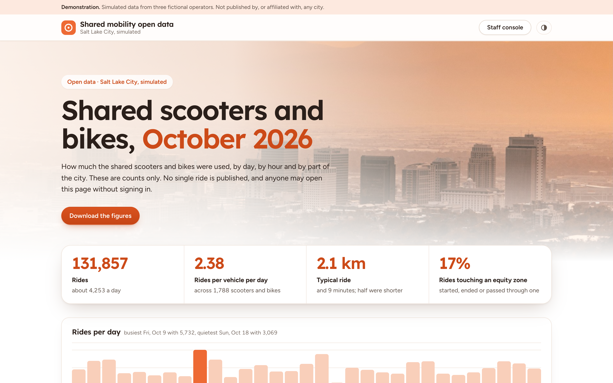

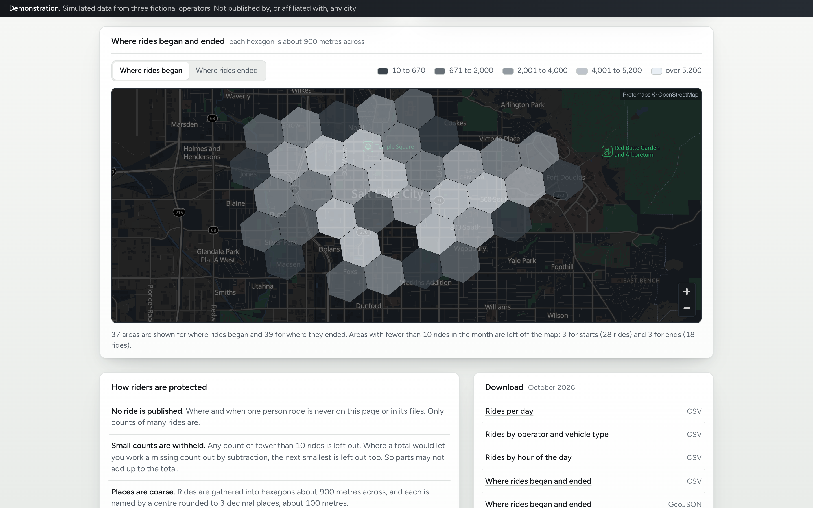

### What an operator sees

Its own standing on each rule, how its fleet measures up at this moment, and what the city is waiting on. Nothing of any other operator.

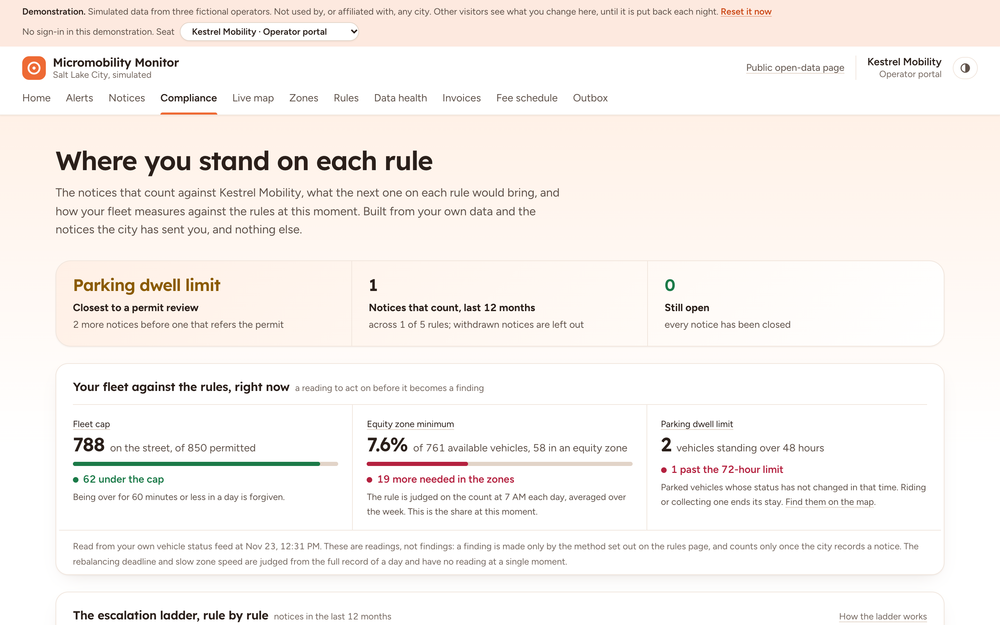

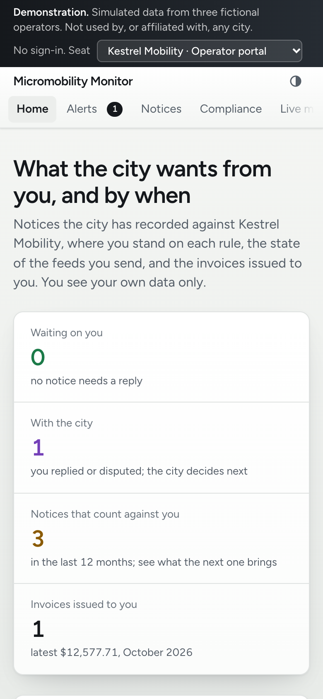

### What city staff see

The program manager's home: where each operator stands and the decisions only that seat can make.

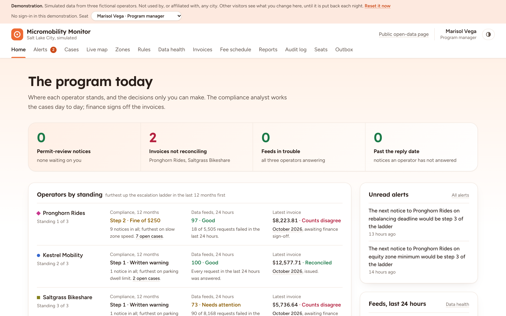

The live map, from the feeds, with the city's zones.

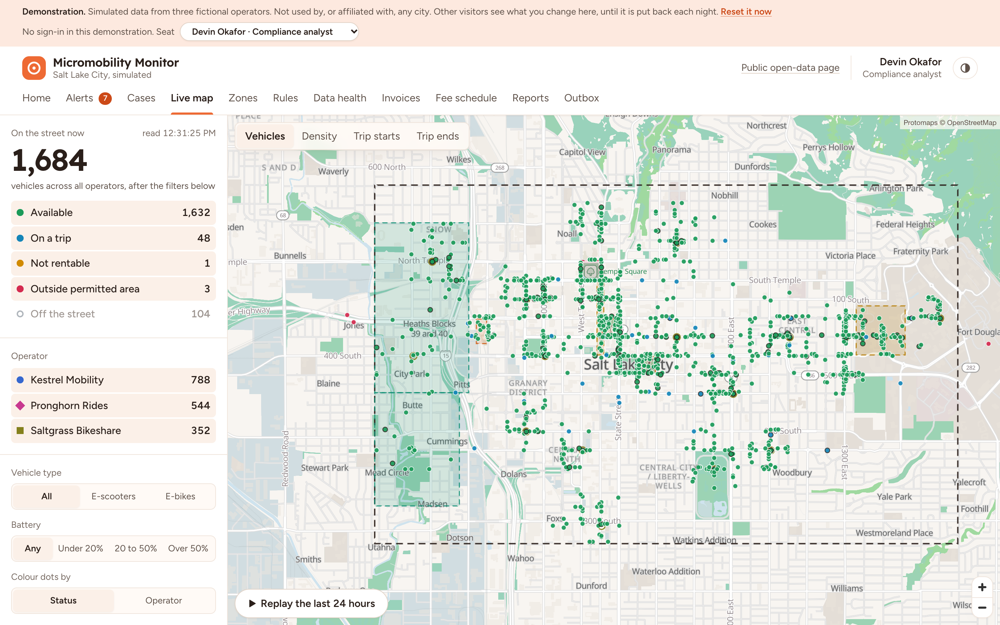

A disputed case, with the escalation ladder and the city's deadline.

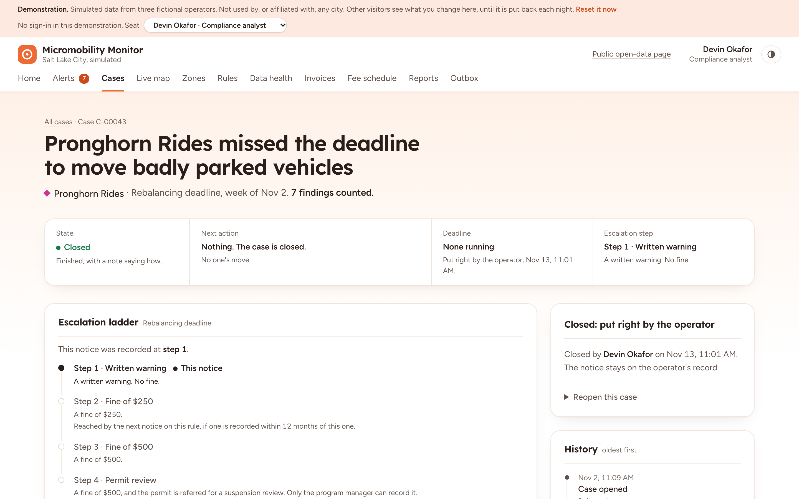

A draft invoice beside the operator's own report.

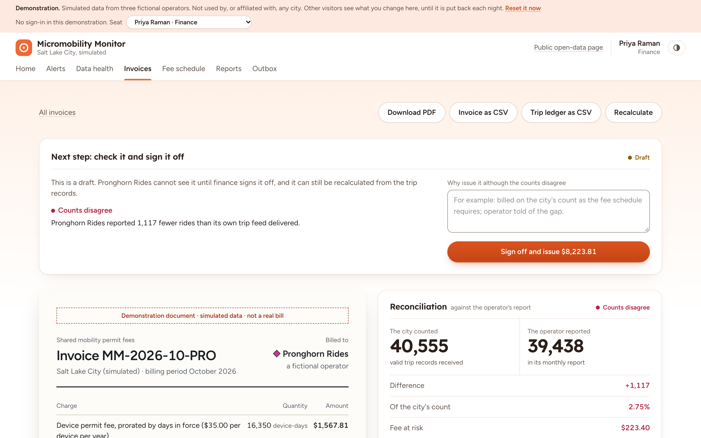

Feed health, policy zones, the monthly report and the audit log.

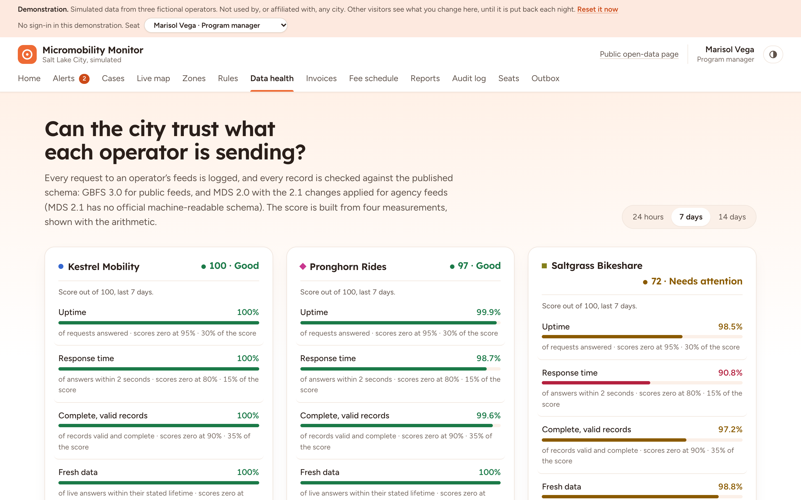

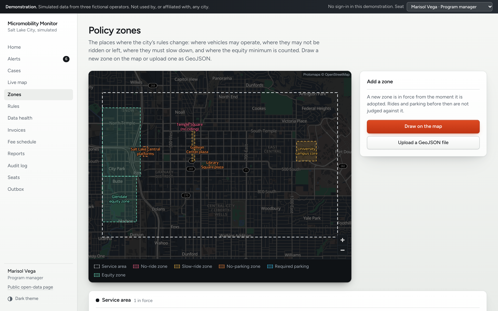

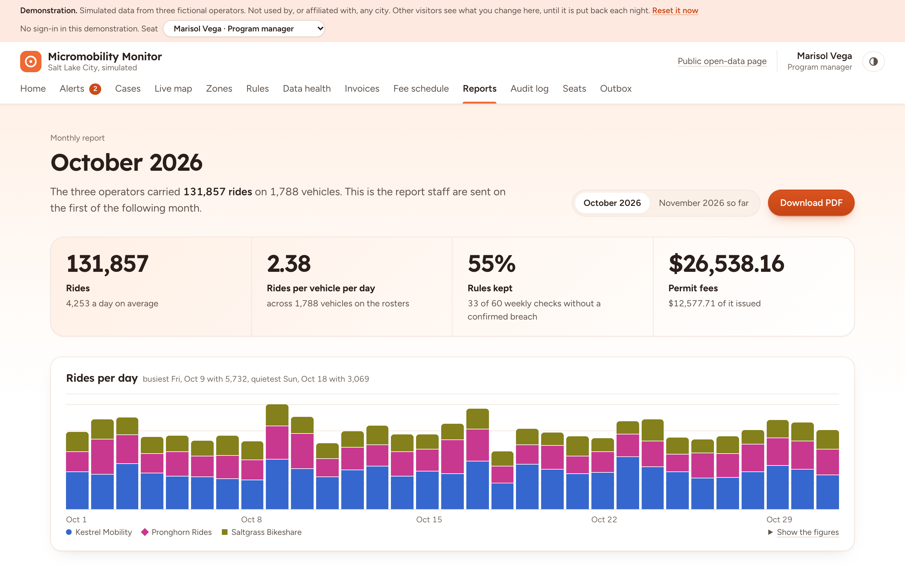

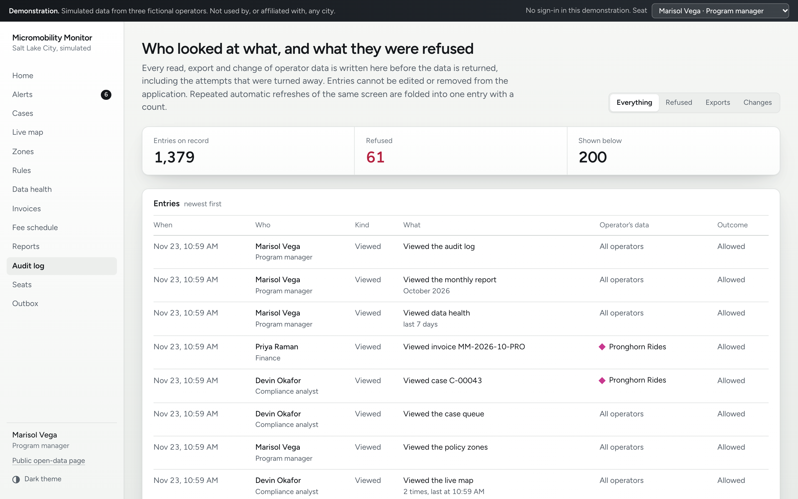

The analyst's queue, and the console in its dark theme.

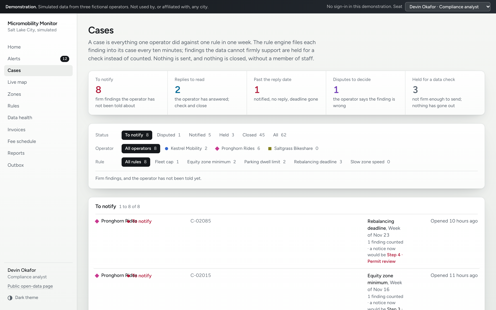

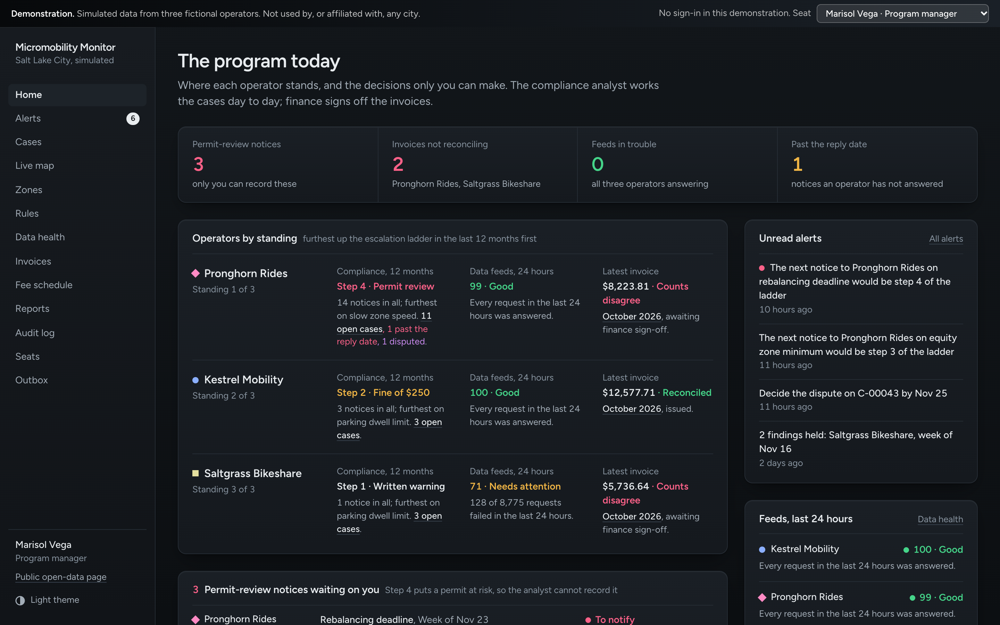

`node scripts/screenshots.mjs` retakes these from a running copy.

## How it would plug into a real program

The simulator stands where real operators would. To use this with a real program:

- Register each operator's real GBFS and MDS addresses and tokens in place of the simulator's. The feeds are the standard ones operators already publish under most permits.
- Connect the city's single sign-on. One function decides who is looking; it has not been connected or tested against a real identity provider.
- Connect a mail service in place of the outbox.
- Enter the city's own zones (drawn on the map or uploaded as GeoJSON), rule settings and fee schedule.

None of that is done here. See [the deploy guide](docs/deploy-guide.txt) and [data privacy and security](docs/data-privacy-and-security.txt), which also list what is not built.

A [two-minute demo script](docs/demo-script.txt) walks through it.

## Stack and architecture

TypeScript throughout. Next.js 16 and React 19 for the web application, PostgreSQL 17 with PostGIS, a background worker with jobs queued in Postgres (pg-boss), MapLibre with a Protomaps basemap served by the application, H3 for the public hexagons, Vitest.

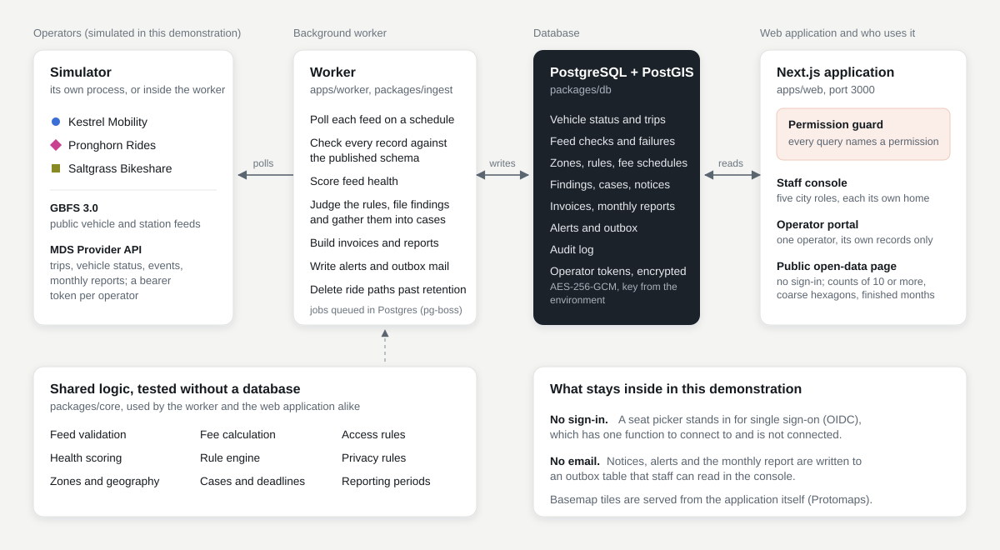

## In detail

- **Simulator.** Three fictional operators (about 1,500 scooters and 300 e-bikes) in downtown Salt Lake City, serving GBFS 3.0 and MDS Provider feeds with commute peaks, weekends, a university area, battery drain, rebalancing, bad parking, rides outside the permitted area, outages and deliberately broken records. Deterministic: the same seed gives the same city.
- **Ingestion and validation.** Per-operator bearer tokens (encrypted at rest), every feed checked against the official schema, every failure logged with the offending record.
- **Data health.** A score per operator built from uptime, response time, valid records and freshness, with the arithmetic shown.
- **Live map.** Filters for operator, vehicle type, status and battery; hex-bin views of fleet density, trip starts and trip ends; replay of the last 24 hours.
- **Fees.** A dated fee schedule ($35 per permitted device per year, $0.20 per ride by default), prorated permits, exemptions, a monthly invoice per operator reconciled against the operator's own monthly report, with CSV and PDF export.
- **Seats and audit.** Six roles: program manager, compliance analyst, finance, IT administrator, read-only and operator portal. Each seat opens on its own home screen, built around what that person needs to know first, and sees only what its role allows; the seats page shows the full permission table. Every read, export and change is written to an audit log, including the refused ones. The demo has a seat picker, labelled as demo mode, in place of sign-in.
- **Policy zones.** Service area, no-ride, slow-ride, no-parking, required-parking and equity zones. An administrator can draw one on the map or upload it as GeoJSON; a zone applies from the moment it is adopted and can be retired without losing its history.
- **Rules.** Fleet cap, equity zone minimum, parking dwell limit, rebalancing deadline and slow zone speed, each with adjustable settings. A change applies from that moment; periods already over are not judged again.
- **Findings and cases.** The worker checks every rule every ten minutes and files each breach once, with its evidence: the hourly fleet count, the vehicles and where they stood, the rides and their speed readings. Findings are gathered into cases: one operator, one rule, one week. Staff work cases, not single findings.
- **Data-confidence check.** A finding inside the GPS margin (15 m), or made while the operator's feed was dropping records or running behind, is held instead of counted. A held finding says why, and staff can release it or set it aside after a check.
- **Notices, replies and disputes.** An operator sees a case only after the city records a notice on it. The operator then has 5 working days to reply or dispute; a dispute gives the city 5 working days to uphold or withdraw. Every step is kept as history.
- **Escalation ladder.** The step of a notice is set by how many earlier notices the operator has had on the same rule in the last 12 months: written warning, $250, $500, then permit review, which only the program manager can record. A withdrawn notice does not count.
- **Alerts and outbox.** Each seat has a bell with its unread alerts, fixed by role and grouped to keep the noise down. Anything a live system would email is written to a visible outbox instead: urgent alerts one at a time, operators' notices as one digest a day. No email leaves the demo.
- **Monthly report.** `/reports`: rides per day, rides per vehicle per day, ride distance and time, peak hours, equity zone coverage, rules kept and permit fees, for any month on record. Sections follow the seat: finance sees no compliance figures. A finished month can be downloaded as a PDF, drawn from the records when it is opened.
- **Scheduled report email.** On the first of each month the worker writes the report email to the outbox for the program manager, analyst and finance seats, with a link to the PDF. Nothing is emailed.
- **Public open-data page.** `/open-data`, outside the staff console and with no seat: counts for finished months only, by day, hour, operator and area, with CSV and GeoJSON downloads. Any count under 10 rides is withheld (and the next smallest where subtraction would reveal it), places are H3 hexagons about 900 m across named by a centre rounded to 3 decimal places, and no single ride is ever published.
- **Operator portal.** Each operator's own seat: the notices to reply to, its feed health, its issued invoices, and a compliance page (`/compliance`) showing the notices that count against it on each rule, what the next one would bring, the day the oldest stops counting, and how its fleet measures against the fleet cap, equity minimum and dwell limit at this moment. It never sees another operator's records, a case before the city has sent a notice, a finding still being checked, the city's notes, or a draft invoice.
- **Privacy and security.** The controls, and what is not built, are set out in [docs/data-privacy-and-security.txt](docs/data-privacy-and-security.txt): raw trips never public, a minimum count of 10, rounded places, route retention, six roles, an audit log of every read, token encryption, and where sign-in (OIDC) would connect. The console sends HSTS, no-framing and no-sniff headers; set `DATABASE_SSL=require` (or `verify-full`) to encrypt the database connection.
- **Route retention.** The path of a ride is kept for `ROUTE_RETENTION_DAYS` (default 90), then deleted by the daily job; the start and end hexagons, distance and duration remain. The worker, the seed and the public page read the setting through one function, and a value that is not a whole number of days falls back to 90.

Not built: a rule for required-parking zones, and sign-in. The seat picker stands in for single sign-on, which has one place to connect and is not connected.

Left out on purpose: a field inspector seat, resident complaints (311) as an input, separate operator accounts for operations and compliance, and assigning a case to a named analyst. Fines are recorded on the notice and are not yet carried onto the invoice. Working days skip weekends but not public holidays.

## Run it locally

Needs Node 22 and Docker.

```bash
cp .env.example .env        # then set TOKEN_ENCRYPTION_KEY: openssl rand -hex 32
npm install
npm run db:up               # PostGIS on port 54329
npm run db:migrate
npm run dev:simulator       # terminal 1: the operators' feeds, port 4010
npm run db:seed             # one month of history, about 400 MB and 2 to 3 minutes
npm run dev:worker          # terminal 2: polls the feeds
npm run dev:web             # terminal 3: http://localhost:3000
```

`npm run db:seed -- --violations` rebuilds only the cases, findings, alerts and outbox from the stored history, in a few seconds.

Two settings are for a copy that strangers share. `DEMO_RESET=1` puts everything a visitor can change back as it was seeded, every night and on request from the strip at the top of the console. `SIMULATOR_INPROCESS=1` makes the worker answer the operators' feeds itself, so the simulator does not need a process of its own.

The hosted copy runs with no worker. `DEMO_CLOCK` stops the clock at the instant the database was seeded for, so every screen counts from there, and a daily scheduled request to `/api/cron/reset` stands in for the worker's nightly reset. Ride paths were removed from that database to fit a free plan; no screen draws them.

`npm run demo` (Docker Compose: database, simulator, seed, worker and web in one command) is written but has not been run end to end yet. The [deploy guide](docs/deploy-guide.txt) covers it, the settings, how the hosted copy was set up and what it does not do.

```bash
npm test            # feed validation, health scoring, fee calculation, rule engine, cases and deadlines, confidence checks, alerts, zone files, access rules, report parsing, exports, privacy rules, reporting periods, and a check that every query in the console passes through the permission guard
npm run typecheck
```

With the database container running (`npm run db:up`), `npm test` also runs the tests that need real SQL: the monthly report's figures and what each seat sees, the public figures and downloads (no count under 10 published or left to be worked out by subtraction, no ride or vehicle identifier, coordinates to 3 decimal places), the monthly email, the route purge, and the operator portal (one operator's seat asking for another's cases, findings, invoices and trip ledger, and for the city's unsent cases, held findings and notes). They use scratch databases named `mm_..._test` on the same server and never touch the demo's data. Without the container they are reported as skipped.

## Standards, stated plainly

- GBFS feeds are checked against the official GBFS 3.0 JSON schemas.
- MDS has no official machine-readable schema for 2.1, so agency feeds are checked against the official MDS 2.0 schemas with the 2.1 changes applied by hand. The app says so on the data health page.
- Equity zone boundaries are illustrative, not the city's real ones.

## Layout

```
apps/simulator   HTTP server for the simulated operators' feeds
apps/worker      scheduled ingestion (pg-boss, queued in Postgres) and the seed script
apps/web         Next.js console
packages/core    pure logic and its tests: validation, health, fees, rules, zones, access, geography, privacy, reporting
packages/db      schema, migrations, token encryption
packages/ingest  polling, hourly ingestion, reports, invoices, violation detection, cases, alerts, monthly report email, route purge
packages/simulator  the simulated city
```

Basemap: Protomaps, map data (c) OpenStreetMap contributors.

---

Built by ChopMedia as a portfolio demonstration. Simulated data, fictional operators, no affiliation with any city. Contact Hayden Huelskamp at chopscales@gmail.com, or on [LinkedIn](https://www.linkedin.com/in/hayden-huelskamp-547a86302/).
